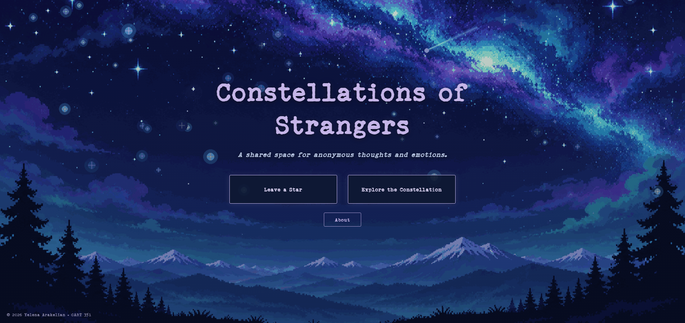
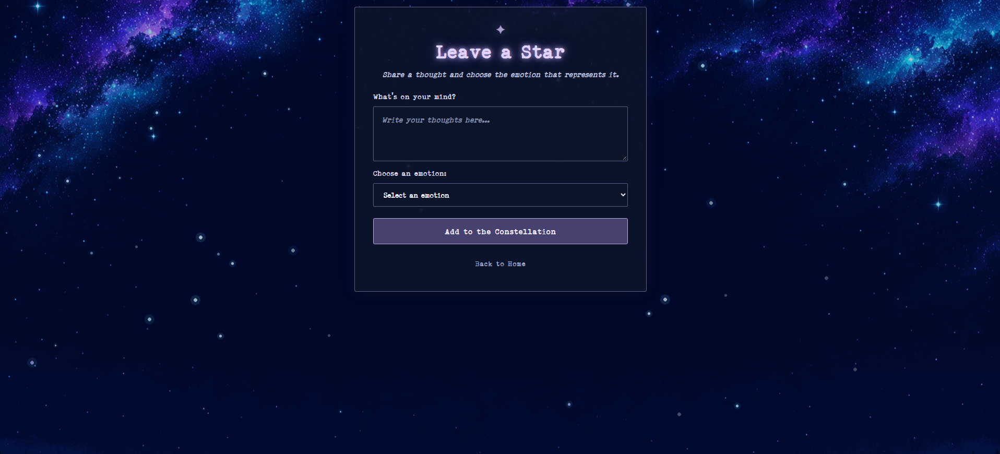
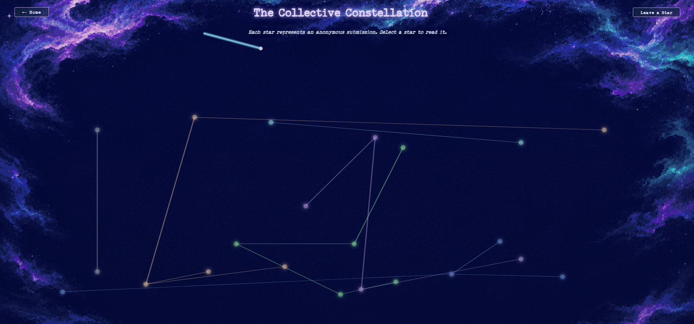
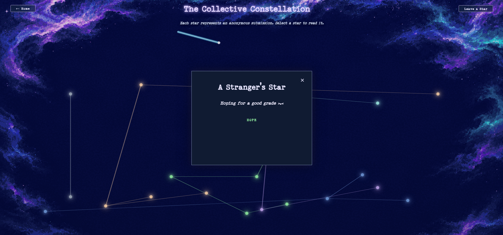
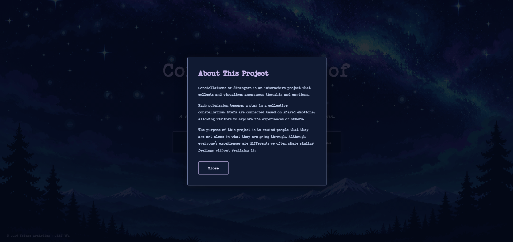

# Constellations of Strangers

**CART 351 – Mini Project One**  
**Yelena Arakelian**

## Project Description

Constellations of Strangers is an interactive website where users can anonymously share their thoughts and emotions. The purpose of this project is to remind people that they are not alone in what they are going through. Sometimes, people feel like they are the only ones dealing with a certain situation or experiencing a particular emotion. However, even though everyone has different experiences, we often share similar feelings without realizing it. I wanted to create a space where people could express themselves without having to reveal their identities. Through this project, I hope visitors can discover that other people may be experiencing something similar to them.

The website has three main sections: the homepage, the submission form, and the collective constellation. Visitors can choose to leave a star or explore thoughts that other people have submitted. When leaving a star, users write an anonymous thought of up to 200 characters and select an emotion from six options: hope, joy, nostalgia, sadness, loneliness, or calm. Once submitted, their thought becomes a glowing star in the collective constellation. Each emotion is represented by a different color, and stars with the same emotion are connected by lines. Visitors can click on individual stars to read the thoughts behind them. I chose a galaxy setting because I wanted each person's contribution to become part of a larger collection. As more people participate, the constellation gradually fills with stars representing different experiences.

An important part of my project is how the information is collected and organized. Each submission contains two pieces of data: a written thought and a selected emotion. Using JavaScript's FETCH requests, this information is sent to a Flask application and stored in a JSON file on the server. Another FETCH request retrieves the saved information and displays it in the collective constellation. JavaScript is also used to determine the positions of the stars and connect those that share an emotion. As more submissions are added, the collective constellation changes. I wanted visitors to see how their individual contributions become part of something shared.

My project connects to Hito Steyerl's reading, A Sea of Data: Apophenia and Pattern (Mis-)Recognition, which discusses how people and systems identify patterns in information, even when those patterns might not represent meaningful relationships. In my project, stars are connected because users selected the same emotion. However, two people who choose sadness might be experiencing it for completely different reasons. The lines suggest a connection, but they cannot fully explain each person's experience. This also relates to Mimi Onuoha's The Point of Collection, which explores how the way data is collected influences what it represents. Since my website only allows users to choose from six emotions, I am already deciding how their feelings will be categorized. Someone might experience several emotions at once, but they can only select one. Both readings helped me understand that the way data is collected and organized can simplify complex experiences and create connections that may not tell the full story.

For the visual design, I chose a pixel-art-inspired galaxy with animated backgrounds, glowing stars, and shooting stars to create a peaceful atmosphere while keeping the website simple and easy to navigate. I used a custom font from DaFont and AI-generated visuals to establish the overall style. I also used ChatGPT to help with debugging and improving the website's layout and interactions. Throughout development, I tested the application and adjusted different features based on how they worked. My expected outcome is for visitors to feel comfortable sharing their thoughts and exploring the experiences of others. Although the connections between stars are created through data, I hope they help visitors recognize that others may share similar emotions, even when their situations are different. Ultimately, I want people to leave the experience feeling a little less alone.

## References

- Steyerl, Hito. (2016). A Sea of Data: Apophenia and Pattern (Mis-)Recognition. e-flux Journal.
  https://www.e-flux.com/journal/72/60480/a-sea-of-data-apophenia-and-pattern-mis-recognition/

-Onuoha, Mimi. (2016). The Point of Collection. Data & Society.
https://medium.com/datasociety-points/the-point-of-collection-8ee44ad7c2fa

## Resources

- HTML, CSS, JavaScript, Flask, Python, and JSON
- Custom font from DaFont: https://www.dafont.com/worldstar.font?text=Constellations+of+Strangers&back=theme
- ChatGPT for debugging and improving layout and interactions.

## Screenshots

### 1. Homepage

### 2. Leave a Star

### 3. Collective Sky

### 4. Selected Star

### 5. About Section

